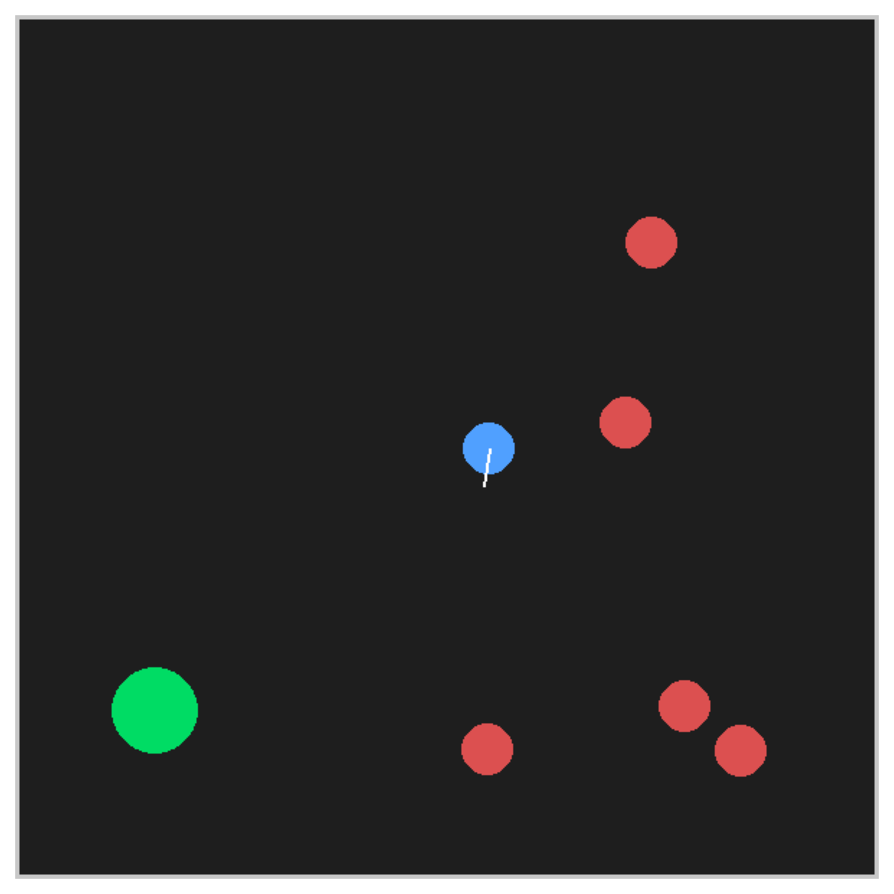
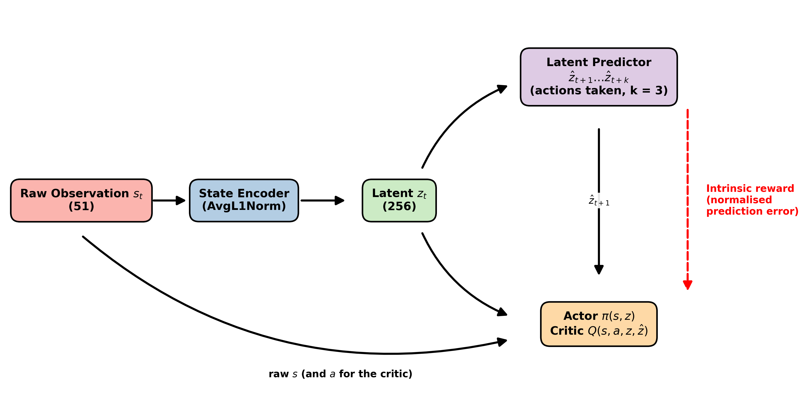
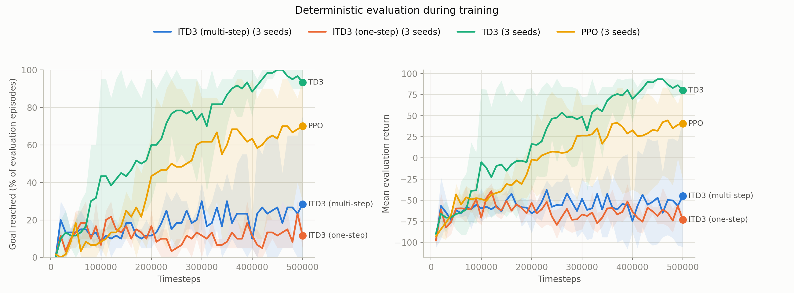
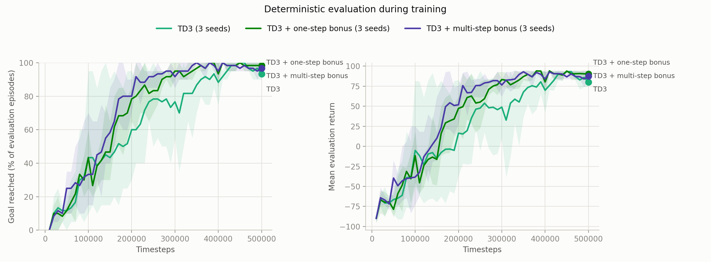

# Adaptive Mapless Navigation in Dynamic Environments

**Author:** Yuval Panet
**Institution:** Ben-Gurion University of the Negev, Department of Industrial Engineering and Management
**Course:** Planning and Reinforcement Learning (364-2-1031), final project

## Overview
Nasti, Najar & Chishti (2025) improve TD3 for mapless robot navigation (ITD3). They add three things: a learned latent state encoder, a predictor of the next latent state, and a curiosity bonus equal to the predictor's error. As future work (their Section 7) they propose a *multi-step* bonus: predict several steps ahead and reward the agent where those longer-range predictions fail.

This project implements that multi-step bonus and tests it in a 2D world with moving obstacles, which the original paper did not evaluate. Six agents are trained on the same task with three seeds each:
- plain TD3;
- TD3 with the one-step curiosity bonus;
- TD3 with the multi-step curiosity bonus;
- ITD3 with the paper's one-step bonus;
- ITD3 with the multi-step bonus;
- PPO.

An ablation separates ITD3's two additions (latent inputs to the actor and critic, and the bonus).

**Main results:**
- **The curiosity bonus improves plain TD3.** With either bonus, 96% of test episodes reach the goal (vs 93%) and collisions roughly halve.
- **The multi-step bonus learned fastest and most consistently.** With three seeds that speed difference is not conclusive.
- **ITD3's full design fails here** (12%). The ablation traces this to its latent inputs to the actor and critic, not to the bonus.



## Environment
`DynamicTrafficEnv` (Gymnasium) is a 10 × 10 m box with a differential-drive robot (blue), a goal (green) and 5 circular obstacles (red), all placed at random each episode. Each obstacle moves at a random constant speed (0.1–0.5 m/s) and turn rate (up to ±0.3 rad/s) and bounces off the walls. Obstacles do not react to the robot or to each other.

| | |
|---|---|
| Observation (51) | 24 LiDAR distances, normalised to [0, 1]. Goal distance, and goal angle relative to the robot's heading. For each obstacle, in the robot's frame: position offset, velocity vector and turn rate |
| Action (2) | Linear and angular velocity in [−1, 1], scaled to ±1 m/s and ±1 rad/s |
| Reward | +100 for reaching the goal, −100 for hitting a wall or an obstacle, −0.1 per step otherwise |
| Episode end | Goal reached, collision, or 500 steps |

## Method


**ITD3**, following the paper:
- **Encoder.** z<sub>t</sub> = AvgL1Norm(f(s<sub>t</sub>)), where f has two hidden layers of 256 and the latent has 256 dimensions. AvgL1Norm scales each latent to a mean absolute value of 1.
- **Predictor.** ẑ<sub>t+1</sub> = P(z<sub>t</sub>, a<sub>t</sub>). It is trained together with the encoder to match z<sub>t+1</sub> = f(s<sub>t+1</sub>) (no gradient through the target), plus an MMD penalty that keeps the latents close to a Gaussian prior (λ<sub>MMD</sub> = 1).
- **Curiosity bonus.** e is the L2 prediction error. The bonus r<sub>int</sub> = β · e / (largest e so far), with β = 0.1, so it lies in [0, 0.1]. It is added to the reward in the critic's target.
- **Actor and critic.** The actor is π(s, z) and the critic is Q(s, a, z, ẑ) with ẑ = P(z, a). The encoder and predictor are trained only by their own loss, not by the critic.

**Multi-step ITD3** (this project):
- The replay buffer returns short sequences, and the predictor is rolled out k = 3 steps with the actions that were actually taken: ẑ<sub>t+j</sub> = P(ẑ<sub>t+j−1</sub>, a<sub>t+j−1</sub>).
- The prediction loss covers all k steps.
- The bonus uses the λ-weighted mean of the k errors (λ = 0.8, as in the paper's proposed Σ<sub>j</sub> λ<sup>j−1</sup>‖ẑ<sub>t+j</sub> − z<sub>t+j</sub>‖), normalised the same way. Steps past the end of an episode are left out.

**TD3** uses the same actor and critic without z and ẑ.

**TD3 + bonus** (one-step or multi-step) is plain TD3 with the curiosity bonus added to its reward. The encoder and predictor are trained only to compute the bonus; the actor and critic never see the latent.

**PPO** uses Stable-Baselines3 with default hyperparameters.

| Hyperparameter | Value |
|---|---|
| Training steps | 500,000 (first 10,000 random) |
| Batch size, discount | 128, 0.99 |
| Hidden layers | 2 × 256 (actor, critic, encoder, predictor) |
| Learning rate | 3e-4 (Adam) for all networks |
| Exploration noise | 0.1 |
| Target policy noise, clip, policy delay, τ | 0.2, 0.5, 2, 0.005 |
| β, λ<sub>MMD</sub>, k, λ | 0.1, 1.0, 3, 0.8 |

**Differences from the paper:**
- Exploration noise is a constant 0.1 (TD3's default); the paper decays it from 1.0 to 0.1.
- Target networks use soft updates with τ = 0.005 (the paper's text says this; its Table 1 says every 250 steps).
- The predictor does not share weights with the encoder.
- The MMD compares the latents with a Gaussian prior, as in the paper's Algorithm 2 (its Section 4.3 compares z with ẑ instead). The prior is scaled to match AvgL1Norm.

**Evaluation:**
- **During training:** every 10,000 steps, each agent runs 20 fixed episodes with deterministic actions.
- **After training:** each agent runs 200 different fixed test episodes.

## Repository structure
| File | Contents |
|---|---|
| `dynamic_traffic_env.py` | The environment, and `run_episodes()` used for all evaluations |
| `train.py` | All TD3-based agents (`--variant`) and their training loop |
| `train_ppo.py` | The PPO baseline (Stable-Baselines3) |
| `run_experiments.sh` | Trains every agent (3 seeds each, plus the ablation), then runs the final test and draws the charts |
| `evaluate.py` | Final test of every trained model, plus a random policy; `--from-logs` compares runs at the same training step |
| `plot_results.py` | Learning curves from the evaluation logs |
| `plot_architecture.py` | Draws the architecture diagram |
| `runs/` | Per agent and seed: training log, evaluation log and trained model. `test_results.md` and `budget_200k.md` hold the result tables |

## Setup
Tested with Python 3.12.
```bash
pip install -r requirements.txt
```

## Usage
Run from the repository root.
```bash
./run_experiments.sh                                # everything: 20 trainings, final test, charts (~4 h on an M3 laptop)
python train.py --variant td3_bonus_multi --seed 0  # one training run: td3 | td3_bonus | td3_bonus_multi | itd3 | itd3_multi | itd3_no_bonus
python train_ppo.py --seed 0
python evaluate.py                                  # final test of every model in runs/
python evaluate.py --from-logs 200000               # compare all runs at the same training step
python plot_results.py                              # learning_curves.png
python plot_results.py --variants td3 td3_bonus td3_bonus_multi --out bonus_curves.png
python plot_architecture.py                         # architecture.png
```

## Results

### Final test (500,000 steps, 3 seeds)
This is the final test: 200 episodes (seeds 0–199) with deterministic actions, from `python evaluate.py`. Values are mean ± std over the three training seeds.

| Agent | Goal reached | Collision | Timeout | Mean return |
|---|---|---|---|---|
| TD3 | 93 ± 2% | 7 ± 1% | 0 ± 0% | 79.1 ± 3.2 |
| TD3 + one-step bonus | **96 ± 1%** | 3 ± 1% | 0 ± 0% | 86.3 ± 2.3 |
| TD3 + multi-step bonus | **96 ± 0%** | 4 ± 0% | 0 ± 0% | 84.2 ± 0.6 |
| ITD3 (one-step) | 12 ± 0% | 57 ± 4% | 31 ± 4% | −73.6 ± 2.4 |
| ITD3 (multi-step) | 26 ± 23% | 63 ± 20% | 11 ± 13% | −50.9 ± 43.8 |
| PPO | 73 ± 25% | 10 ± 1% | 17 ± 24% | 45.4 ± 39.4 |
| Random policy | 0% | 62% | 38% | −94.3 |



### The curiosity bonus on plain TD3


How fast each agent learned, from the evaluations during training:

| Agent | Mean success over training | Steps until the first evaluation ≥ 80% (each seed) |
|---|---|---|
| TD3 | 64% | 100k, 250k, 360k |
| TD3 + one-step bonus | 71% | 160k, 200k, 260k |
| TD3 + multi-step bonus | 74% | 150k, 180k, 190k |

### Ablation: why does ITD3 fail?
ITD3 adds two things to TD3: latent inputs to the actor and critic, and the curiosity bonus. All agents are compared at the same point in training, using the evaluations at 160k–200k steps (`python evaluate.py --from-logs 200000`). The ITD3-without-bonus runs were trained for 200,000 steps with 2 seeds.

| Agent | Latent inputs | Curiosity bonus | Seeds | Goal reached |
|---|---|---|---|---|
| TD3 | – | – | 3 | 52 ± 29% |
| TD3 + one-step bonus | – | one-step | 3 | 69 ± 12% |
| TD3 + multi-step bonus | – | multi-step | 3 | 77 ± 12% |
| ITD3 without bonus | ✓ | – | 2 | 14 ± 1% |
| ITD3 (one-step) | ✓ | one-step | 3 | 13 ± 2% |
| ITD3 (multi-step) | ✓ | multi-step | 3 | 13 ± 2% |

### Findings
- **The curiosity bonus improves plain TD3.**
  - With either bonus, 96% of test episodes reach the goal instead of 93%, and collisions roughly halve (3–4% vs 7%).
  - Every bonus seed scored at least as well as the best plain-TD3 seed.
- **The multi-step bonus learned fastest and most consistently, but not conclusively.**
  - All three of its seeds passed 80% success between 150k and 190k steps, against 160k–260k for the one-step bonus and 100k–360k for TD3.
  - It also has the highest mean success over training: 74%, against 71% and 64%.
  - By the end of training both bonuses are equal (96%).
  - With three seeds, these speed differences are within seed-to-seed variation.
- **ITD3 itself fails in this environment** (12% one-step, 26% multi-step). Its agents mostly learn to avoid crashes by stalling: at 200k steps about half of their episodes end in a timeout.
- **The cause is ITD3's latent inputs to the actor and critic, not its bonus.** ITD3 without the bonus fails just as badly, while the same bonus on plain TD3 helps.
- **PPO is unstable across seeds.** It reaches about 91% on two seeds but stalls on the third (38%, with 51% timeouts).

A likely reason for the latent-input failure, not tested here: the encoder keeps changing as it learns, so the meaning of the actor's and critic's inputs drifts. TD7, whose design ITD3 closely follows, keeps fixed copies of the encoder for the actor and critic and refreshes them only every 250 steps to keep their inputs stable. The ITD3 paper does not do this.

**Future work:**
- ITD3 with TD7-style frozen encoder copies.
- More seeds, to confirm the learning-speed difference between the one-step and multi-step bonus.
- Harder settings, such as more or faster obstacles, where exploration matters more.

## Limitations
- The agents use three seeds (two for the ITD3-without-bonus ablation), so only large or very consistent differences are reliable. The 3-point gain from the bonus is consistent across seeds; the differences in learning speed are not yet.
- No agent was tuned. PPO uses default hyperparameters, and ITD3 uses the paper's values.
- The simulation is simple: the robot has idealised motion, obstacles ignore the robot, and the observation gives exact obstacle positions and velocities, which a real robot would have to estimate.
- The bonus is normalised by the largest error seen so far, so it shrinks as the predictor improves; it was around 0.0015 per step by the end of training.

## References
- Nasti, S. M., Najar, Z. A., & Chishti, M. A. (2025). Adaptive mapless mobile robot navigation using deep reinforcement learning based improved TD3 algorithm. *Frontiers in Robotics and AI*, 12, 1625968. https://doi.org/10.3389/frobt.2025.1625968
- Fujimoto, S., van Hoof, H., & Meger, D. (2018). Addressing function approximation error in actor-critic methods. *ICML*. (TD3)
- Fujimoto, S., Chang, W.-D., Smith, E. J., Gu, S. S., Precup, D., & Meger, D. (2023). For SALE: State-action representation learning for deep reinforcement learning. *NeurIPS*. (AvgL1Norm)
- Schulman, J., Wolski, F., Dhariwal, P., Radford, A., & Klimov, O. (2017). Proximal policy optimization algorithms. arXiv:1707.06347.
